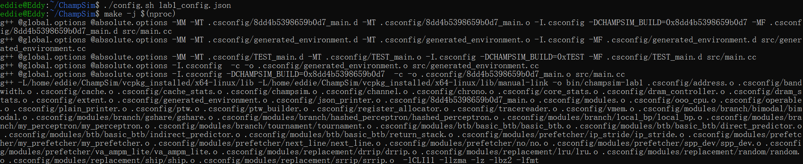
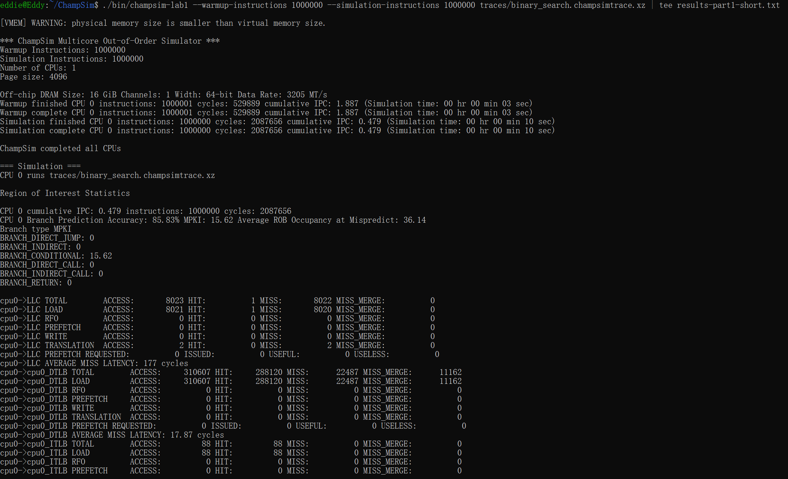
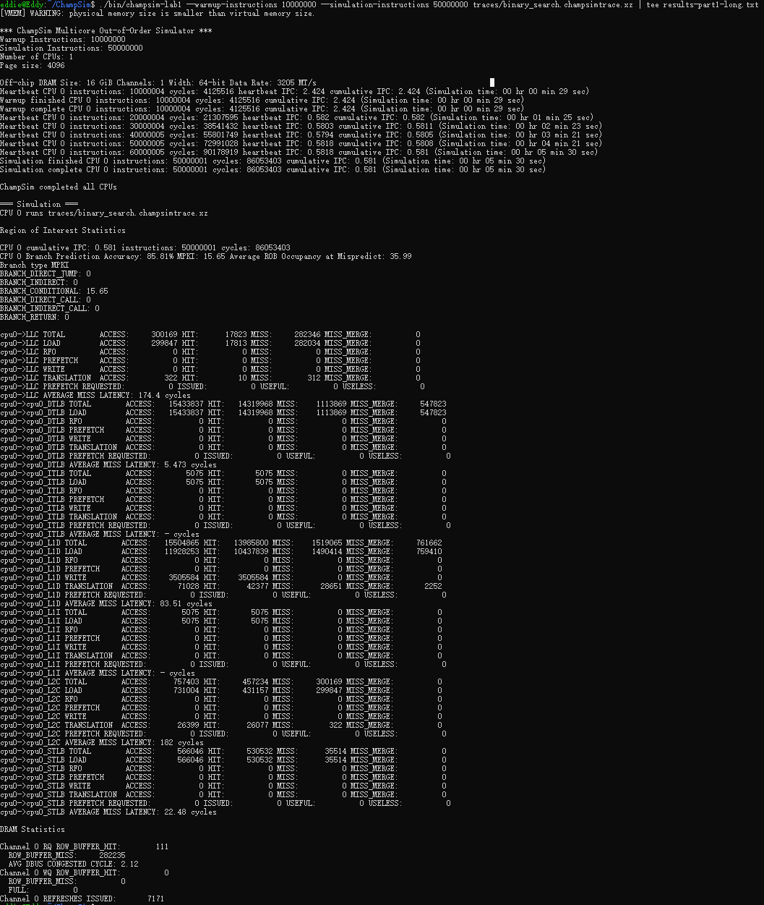

# Project 1 Report

**2300010631, Yudi Wu, School of Mathematical Sciences**

## Overview

This project focuses on setting up the required environment for conducting computer architecture experiments. Specifically, we use ChampSim to simulate processor microarchitecture and the memory hierarchy. The first step involves setting up a manual environment in WSL2 (Ubuntu 22.04) instead of Docker, and installing ChampSim within it. During the installation process, we clone the ChampSim code repository from GitHub, resolve dependencies using vcpkg, and compile it. Afterward, we configure a customized processor system using a JSON configuration file and execute a specific instruction trace (binary_search) to evaluate the performance of the simulated system.

## Configuration and Compilation

We successfully set up a manual environment in WSL2 (Ubuntu 22.04) instead of using Docker. We used the provided basic configuration file `lab1_config.json` and resolved all dependencies via `vcpkg` (which involved manually downloading packages due to GitHub network constraints). We then compiled the source code by running `./config.sh lab1_config.json` and `make -j $(nproc)`. The successful compilation generated the executable `bin/champsim-lab1`. A screenshot of the successful configuration and compilation is shown below.


*Figure 1: Successful configuration and compilation of ChampSim.*

## Simulation and Results

### Short Simulation

To verify that the simulator works correctly, we ran a short simulation with the `binary_search` trace. We used 1,000,000 warmup instructions and 1,000,000 simulation instructions. The output was saved using the `tee` command for further analysis. The command used is shown below:

```bash
./bin/champsim-lab1 --warmup-instructions 1000000 \
                    --simulation-instructions 1000000 \
                    traces/binary_search.champsimtrace.xz \
                    | tee results-part1-short.txt
```

The simulation finished without errors and successfully generated the performance statistics. A screenshot of the successful execution is shown below.


*Figure 2: Successful execution of ChampSim with the binary_search trace (Short test).*

### Long Simulation

After verifying the simulator with the short test, we ran a long simulation to obtain representative performance data for the report. We used 10,000,000 warmup instructions and 50,000,000 simulation instructions. The command used is shown below:

```bash
./bin/champsim-lab1 --warmup-instructions 10000000 \
                    --simulation-instructions 50000000 \
                    traces/binary_search.champsimtrace.xz \
                    | tee results-part1-short.txt
```

A screenshot of the successful long simulation is shown below.


*Figure 3: Successful execution of ChampSim with the binary_search trace (Long test).*

### Comparison of Simulation Results

The key performance metrics from both the short and long simulations are summarized in Table 1.

**Table 1: Comparison of Short and Long Simulation Results**

| Metric                     | Short Simulation (1M/1M) | Long Simulation (10M/50M) |
| :------------------------- | :----------------------- | :------------------------ |
| Cumulative IPC             | 0.479                    | 0.581                     |
| Branch Prediction Accuracy | 85.83%                   | 85.81%                    |
| Branch MPKI                | 15.62                    | 15.65                     |
| L1D Total Accesses         | 1,650,485                | 16,504,856                |
| L1D Total Misses           | 251,985                  | 1,510,696                 |
| L1D Miss Rate              | 15.27%                   | 9.15%                     |
| LLC Total Accesses         | 8,023                    | 300,169                   |
| LLC Total Misses           | 8,022                    | 282,346                   |
| LLC Miss Rate              | 99.99%                   | 94.06%                    |

As shown in Table 1, the long simulation exhibits a more stable performance state. The cumulative IPC increases from 0.479 to 0.581, and the L1D miss rate drops significantly from 15.27% to 9.15% after the longer warmup phase. However, the LLC miss rate remains extremely high (over 94%) due to the random memory access pattern of the `binary_search` workload, which remains the primary bottleneck preventing a higher IPC.

## Workflow Description

The complete workflow of ChampSim consists of four main steps: configuration, compilation, trace execution, and statistics collection.

1. **Configuration**: We define the processor microarchitecture parameters in `lab1_config.json`, including CPU core settings, cache hierarchy (L1I, L1D, L2C sets and ways), and the branch predictor type (`hashed_perceptron`).
2. **Compilation**: We run `./config.sh lab1_config.json` to generate the build configuration, followed by `make -j $(nproc)` to compile the source code. This generates the executable `bin/champsim-lab1`.
3. **Trace Execution**: We run the executable with a provided trace file (e.g., `binary_search.champsimtrace.xz`). We specify the number of warmup instructions and simulation instructions using command-line arguments.
4. **Statistics Collection**: After the simulation completes, ChampSim outputs detailed performance statistics (such as IPC, branch prediction accuracy, and cache hit/miss rates) to the terminal. We use the `tee` command to save this output to a text file for further analysis.
